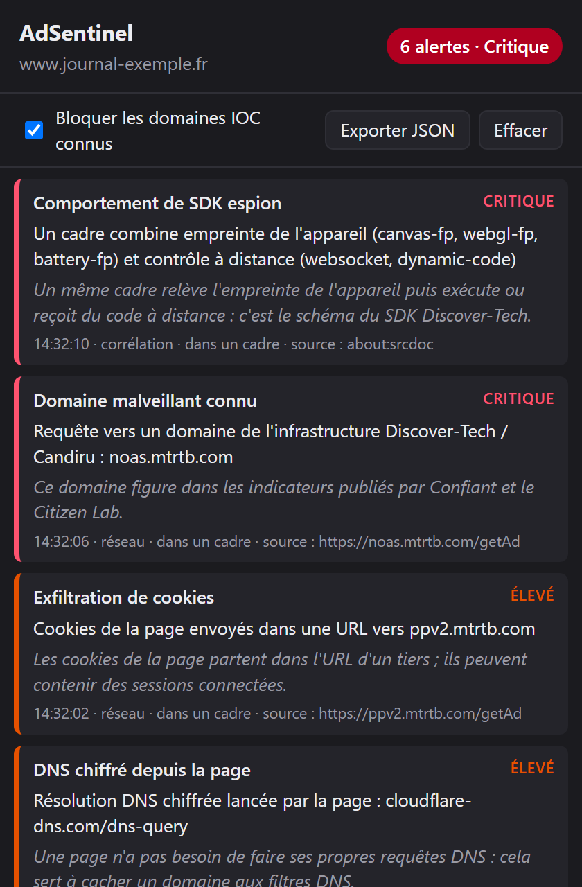

# AdSentinel

Extension Chrome / Edge (Manifest V3) qui détecte les comportements suspects des publicités,
à partir des techniques décrites dans les rapports Confiant et Citizen Lab sur Discover-Tech et Candiru (2026).

Créée par **Roubai Chorfi Boumediene**.


<p align="center">
  
</p>

## Installation

1. Ouvrir `chrome://extensions` (ou `edge://extensions`).
2. Activer le **mode développeur**.
3. Cliquer sur **Charger l'extension non empaquetée** et choisir le dossier `ad-sentinel`.
4. Épingler l'icône AdSentinel dans la barre d'outils.

## Tester avec la page de démo

Servir le dossier `test` en local, par exemple :

```bash
python -m http.server 8000 --directory test
```

Puis ouvrir <http://localhost:8000/demo.html>, cliquer sur **Afficher la « publicité » simulée**
et ouvrir le popup. La démo ne contacte que des domaines `.invalid` et une IP de documentation (203.0.113.10).

## Ce qui est détecté

| Signal | Où | Lien avec l'attaque |
|---|---|---|
| Domaine IOC connu | réseau | Infrastructure Discover-Tech, CloudFront Candiru, C&C DevilsTongue |
| Empreinte + contrôle à distance dans un même cadre | corrélation | Schéma du SDK `trustlayersdk` |
| Cookies envoyés dans une URL | réseau | Vol de cookies `getCookies()` avec séparateur `~~~` |
| DNS-over-HTTPS lancé par la page | réseau | Helper DoH du SDK pour cacher les domaines |
| Contact d'une IP brute | réseau | Suite du DoH : connexion à l'IP sans nom d'hôte |
| `new Function(...)` | page | Exécution du code envoyé par le C2 |
| WebSocket / WebRTC | page | Canal C2 persistant, fuite d'IP derrière un VPN |
| Lecture de `document.cookie` par un tiers ou un cadre | page | Accès aux cookies de l'éditeur |
| Canvas, WebGL (carte graphique), batterie | page | Empreinte de l'appareil |
| Écoute souris / clavier / défilement depuis un cadre | page | Surveillance comportementale anti-robot |
| `/getAd`, cadre CloudFront anonyme | réseau | Chargeur NOAS et couche de livraison |

Le bouton **Bloquer les domaines IOC connus** ajoute une règle `declarativeNetRequest` qui bloque la liste de `iocs.js`.
Chaque alerte **critique** déclenche aussi une notification système (une seule par type et par page).

Un script d'un domaine tiers qui **prend l'empreinte de l'appareil et lit les cookies** du site est signalé
comme « Script tiers qui profile », même sans canal C2. Les scripts courants et légitimes listés dans
`TRUSTED_SCRIPT_DOMAINS` (Google Analytics, reCAPTCHA…) apparaissent en « Confiance » et ne comptent pas
dans le badge, sauf s'ils exécutent du code dynamique ou ouvrent un canal.

## Enregistreur forensique

L'enregistreur garde la trace de **tout ce que font les publicités** pour comprendre comment un exploit est livré.
Il s'ouvre depuis le popup (**Ouvrir l'enregistreur**).

- **Mode enquête** (case du popup) : journal complet de chaque visite. Il garde chaque requête, chaque
  redirection avec son code HTTP, chaque réponse avec l'IP du serveur, l'arbre des cadres (qui charge qui),
  les pop-ups ouverts par une pub, les alertes et les messages WebSocket. Il garde les 30 dernières visites,
  jusqu'à 5 000 événements chacune.
- **Captures, toujours actives** : le code reçu par un cadre publicitaire ou un script tiers est enregistré
  en entier avec son **SHA-256**. Cela couvre le corps de `new Function`, les modules WebAssembly, les scripts
  de Worker générés et les gros messages WebSocket, soit jusqu'à 200 captures de 2 Mo chacune. Un exploit
  n'est envoyé qu'une fois : la capture est souvent la seule preuve.
- **Signes d'exploitation** : compilation WebAssembly, pulvérisation mémoire (500 tampons de 64 Ko ou plus
  en moins de 2 s, depuis un cadre), Worker lancé depuis du code généré, `SharedArrayBuffer`.

Dans la page Enregistreur, la chronologie se filtre par type d'événement, par cadre et par mot-clé.
Une visite s'exporte en JSON avec le code capturé, et chaque capture se télécharge (`.wasm`, `.bin`
ou `.js.txt`, pour ne pas s'exécuter par un double-clic) ou se cherche sur VirusTotal par son empreinte.

> Analyse le code capturé dans une machine virtuelle isolée, jamais sur ton poste principal.

## Développement

Les tests de l'analyse réseau et de la corrélation tournent sous Node.js 22 ou plus récent, sans dépendance :

```bash
npm test
```

GitHub Actions les relance à chaque push. Pour régénérer les icônes après une modification du dessin :

```bash
powershell -ExecutionPolicy Bypass -File scripts/make-icons.ps1
```

La capture du README vient de `docs/preview.html`, qui affiche le vrai popup avec des alertes d'exemple.

## Structure

- `inject.js` : sondes dans le contexte de la page (world MAIN), dans tous les cadres.
- `content.js` : relais des événements vers le service worker.
- `background.js` : analyse réseau (`webRequest`), corrélation par cadre, badge et blocage.
- `recorder.js` : journal des visites et captures de code (SHA-256), côté service worker.
- `recorder.*`, `recorder-ui.js` : page Enregistreur (chronologie, arbre des cadres, captures).
- `iocs.js` : indicateurs de compromission, serveurs DoH et scripts de confiance ; à mettre à jour.
- `popup.*` : interface des alertes, export JSON.
- `icons/` : icônes générées par `scripts/make-icons.ps1`.
- `tests/` : tests Node.js avec un faux objet `chrome`.
- `docs/` : page d'aperçu et capture d'écran.

## Limites

- **Ne reconnaît pas une faille inconnue par sa signature** : il capture le code livré et repère les signes
  d'exploitation (WebAssembly, pulvérisation mémoire, Worker généré). Ce qui se passe hors du navigateur
  (sortie du bac à sable, implant) relève d'un outil système comme Sysmon.
- La pulvérisation mémoire n'est surveillée que dans les cadres, pour ne pas ralentir les sites.
- Un attaquant qui connaît l'extension peut repérer les sondes (Proxy) et ne rien faire.
  C'est d'ailleurs un effet utile : le SDK reste silencieux face à un environnement d'analyse.
- `eval` n'est pas surveillé, car l'envelopper casse le comportement de `eval` direct.
- Une page peut fabriquer de fausses alertes en déclenchant l'événement `__adsentinel`.
- Faux positifs possibles : visioconférence (WebRTC), régies légitimes (`/getAd`), scripts anti-fraude (empreinte).
  C'est la **combinaison** de signaux dans un cadre publicitaire qui compte.

## Licence et crédits

Distribué sous licence **MIT** : voir [LICENSE](LICENSE).
Tu peux utiliser, modifier et redistribuer ce code, y compris dans un projet commercial,
à condition de **conserver la mention de copyright et le texte de la licence**.

Si tu t'appuies sur AdSentinel dans un projet, un article ou une présentation, cite-le ainsi :

> AdSentinel, par Roubai Chorfi Boumediene — https://github.com/RoubaiChorfiBoumediene/AdSentinel

Sources des indicateurs : rapports de [Confiant](https://www.confiant.com/) et du
[Citizen Lab](https://citizenlab.ca/research/how-discover-tech-turned-targeted-ads-into-a-pipeline-for-spyware/).
